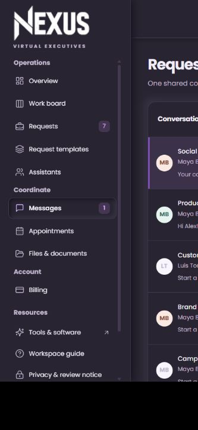

# NexusVA - Test Version 1.3.4.9

This branch proposes the cumulative NexusVA changes through **1.3.4.9** for review. It is based on this repository's `main` at **0.2.0** (`269e6e1`). Opening this pull request does not merge, deploy, or change the running application or an external database.

## Latest update: 1.3.4.9

Removed the shared header's **Workspace > current page** breadcrumb, including the Messages label shown in the reference. The mobile navigation button, header controls, page headings, sidebar, existing spacing and styling are retained. This revision changes three rendered breadcrumb elements; it does not change notification handlers, business logic, integrations or CSS.



See [revision 1.3.4.9](REVISION-1.3.4.9.md) and [its validation record](VALIDATION-1.3.4.9.md).

## Additions since the last update on main

The previous `main` is 0.2.0, so this PR contains more than the latest header change:

| Area | Behavior available in 1.3.4.9 |
| --- | --- |
| Appearance and layout | Nexus branding, persistent light/dark appearance, shared neumorphic styling, responsive workspace layouts and contextual feedback. |
| Owner dashboard | Business summaries, actionable decision lists, period presets/custom dates, optional comparison and scoped CSV export. |
| Client and VA dashboards | Compact date filters without Compare; role-specific summaries with date definitions; current work, deadlines and handovers stay visible across historical filters. The VA dashboard has no Reply needed panel. |
| Work management | Role-scoped work board, Admin client directory and request templates, using existing request/payment/delivery flows. |
| Time and attendance | Task-linked clock-in/out, breaks, idle/sleep checks, scheduled clock-out and unverified-time flags. VA status is read-only; only Admin manages corrections, review, verification and tracking rules. |
| Notifications (1.3.4.8) | Clickable actual-record destinations, read/unread controls, snapshot-based Mark all read, reversible dismissal/restore, immediate status updates, error/retry feedback and keyboard/touch interaction. |
| Automatic notification updates | Existing local browser/change events, including other tabs; connected Supabase retains its 15-second polling. Ambiguous legacy notifications open a relevant list or their actual details. |
| Privacy oversight | Case-based, approved and audited review of conversations/attachments and historical schedules. Operational Admin status alone does not grant direct private-message/calendar access. |
| Header (1.3.4.9) | Breadcrumb labels/separator removed while retaining the existing header and mobile menu. |

Release details: [1.3.4.7 dashboards and attendance](REVISION-1.3.4.7.md), [1.3.4.8 notifications](REVISION-1.3.4.8.md), [change log](CHANGELOG.md), and [prior 0.2.0 README](docs/README-0.2.0.md). Earlier Git history and release tags are preserved.

## Run this branch locally

Requires Node.js **22.18+** and npm:

```sh
git fetch origin
git switch codex/nexusva-1.3.4.9-review
npm ci
npm run dev
```

Open **http://127.0.0.1:5189/**. If another 1.3.4.9 preview is already using that port, run `npm run dev -- --port 5190` and open the printed URL. On Windows, `Open Nexus VA.cmd` starts the existing background launcher on port 5189.

With no Supabase settings, choose Client (Alex), VA (Maya) or Admin (Jordan) from the demo sign-in page. Switch roles from the Account menu. Sample records stay in browser storage for that origin. Do not enter real personal or financial data into the demo.

## Reviewer checklist

- Open Messages on desktop and mobile: the breadcrumb is absent, the real page heading remains, and the mobile menu opens/closes.
- Open notifications: select a notice to view the linked request/conversation, toggle read/unread, dismiss it, then restore it. Changes should persist after reload.
- Compare Client/VA dashboard date ranges: cards change for the selected period while current actions remain available; neither role has Compare.
- Switch to VA: check clock-in/break/resume/out and read-only verification status. Switch to Admin to review/manage ended time entries. Review flags and deliverables rather than treating browser activity as proof of productivity.
- Follow a request through assignment, participant messages, simulated payment, delivery and Client approval. Privacy/ownership checks should still apply.

## Validation

`npm run check` runs the automated tests, TypeScript and the development build. The source revision passed **101 tests across 8 files**, type checking and the development build. Tests include the full migration chain in local PGlite, workflow/privacy permissions, notification ownership/targets/status, reporting and attendance rules. [Browser validation](VALIDATION-1.3.4.9.md) covers the latest header change, notification control and mobile navigation. The main bundle has an existing nonfatal size advisory around 507 KB.

These checks do not establish live Supabase, provider email/payment integration, production deployment or a full accessibility/device audit.

## Connected backend and limits

The demo works without a backend. For an existing connected environment, review and apply **only unapplied** migrations in chronological order:

1. `supabase/migrations/202610270001_workspace.sql`
2. `supabase/migrations/202611050001_privacy_roles.sql`
3. `supabase/migrations/202611050002_private_review.sql`
4. `supabase/migrations/202611150001_notification_actions.sql`

The privacy migrations change access boundaries. The notification migration adds target metadata, dismissal and own-user notification commands while retaining the existing public RPC and RLS. No migration was applied to a live database as part of this PR. Follow [environment setup](docs/WORKFLOW.md); only public anon/publishable keys belong in frontend configuration. Credentials and non-example environment files are excluded from Git.

**Payments remain simulated. Attendance remains browser-local:** device time and in-app activity cannot verify productivity or work in Excel, calls or other apps. Server-authoritative attendance/production payroll integration is not implemented. Connected attendance stays unavailable until that integration exists. External messaging, email and payment-provider delivery require their own configuration and live verification. No deployment is included.
